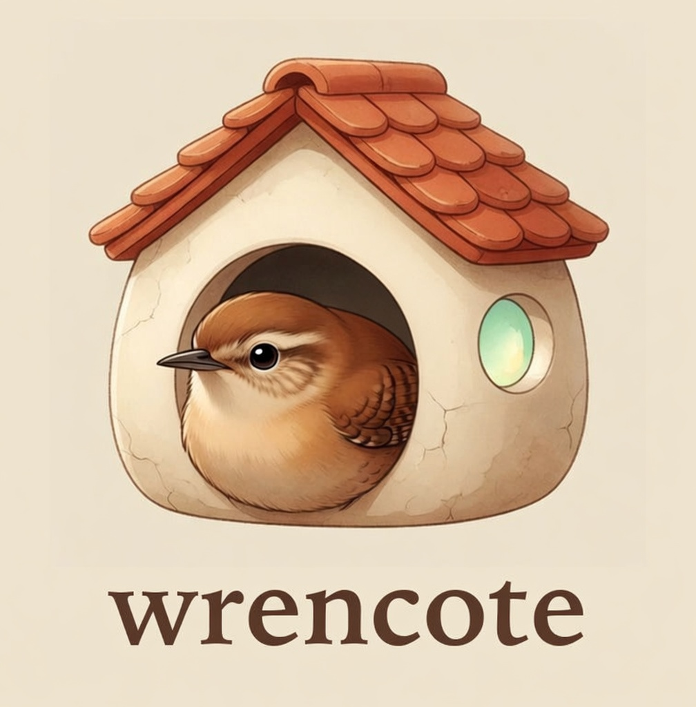

<p align="center">
  
</p>

# Wrencote

Wrencote is a small embeddable HTTP runtime for the [Wren](https://wren.io) scripting language. Wren
has no ambient I/O by design; Wrencote supplies the host layer: an epoll event loop, HTTP/1.1,
capability-gated filesystem and environment access, JSON, and a router.

```wren
import "net" for Server, Req, Res
import "json" for Json

Server.serve { |req, res|
  if (req.path == "/health") res.send(200, "ok\n")
  else res.send(404, "not found\n")
}
```

## Build

```sh
cmake --preset release
cmake --build --preset release
./build/release/wrencote run examples/app.wren --listen 127.0.0.1:8080 --allow http,json
```

The CLI applies Landlock and a seccomp allowlist by default; `--no-sandbox` is for development.

## Container

`Dockerfile` builds a small runtime image: the CLI and `examples/`, without the compiler. CI builds
this image and does not push it to a registry.

```sh
docker build -t wrencote .
docker run --rm -p 8080:8080 wrencote
curl -s http://127.0.0.1:8080/health
```

That serves `examples/app.wren` on port 8080 with the usual Landlock and seccomp sandbox. If a
runtime blocks those, add `--no-sandbox`. To serve a script from the current directory:

```sh
docker run --rm -p 8080:8080 -v "$PWD":/work -w /work wrencote \
  run app.wren --listen 0.0.0.0:8080 --allow http,json
```

## Release artifact

The v0.2 artifact is a glibc build with TLS/HTTP2 (OpenSSL and nghttp2). The v0.1 artifact remains a
static musl HTTP/1.1 build (`tools/build_musl.sh`).
The source build above uses the host compiler.

## Docs

- `docs/embedding.md` — install, link, lifecycle, errors
- `docs/cli.md` — command-line options
- `docs/stdlib.md` — `net`, `http`, `fs`, `sys`, `json`, `router`
- `docs/security.md` — threat model and residual risks
- `docs/performance.md` — measured request budget

## Status

v0.2.1 adds TLS and HTTP/2 (ALPN, multiplexing, h2spec-clean). v0.1.0 remains HTTP/1.1-only. See
`CHANGELOG.md` and `docs/http2.md`.

## Licence

MIT. Wren is MIT; see `third_party/wren/LICENSE`.
